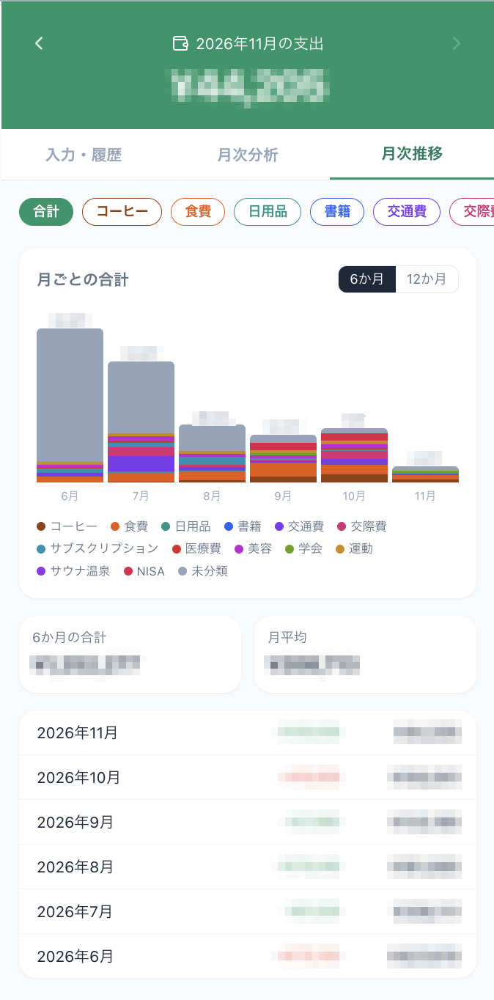

# My家計簿

三井住友カードの利用通知メールを GAS で自動取り込みし、PayPay・現金は手入力できる PWA 家計簿。
Next.js + Supabase + Google Apps Script。

  

## 機能

画面は 3 つのタブで、横スワイプでも切り替えられる。月は画面上部の矢印で切り替える（全タブ共通）。

### 入力・履歴タブ
- **支出の手入力**: 金額・店名・日付・カテゴリ・支払い方法（PayPay / 現金 / その他）を入力して追加する。
- **レシート読み取り（任意）**: レシートを撮影すると、Gemini が金額・店名・日付・カテゴリ・支払い方法を読み取って入力欄に埋める。確認・修正してから追加する。1 日の回数に上限がある。
- **履歴の一覧**: 選んだ月の支出を表示する。並び順は日付の新しい順・古い順、金額の高い順・低い順から選べる。
- **カテゴリの変更・追加**: 履歴の各行でカテゴリを選び直せる。カテゴリは自分で追加できる。
- **削除**: 履歴から支出を削除できる。

### 月次分析タブ
- **日別カレンダー**: 月曜始まりで、各日の支出合計を表示する。支出が多い日ほど背景が濃くなる。
- **日別の内訳と追記**: 日をタップすると、その日の支出の内訳が出る。そこから、その日の支出を追加できる。
- **カテゴリ別の円グラフ**: 構成比を円グラフで表示し、各カテゴリの金額・割合・件数を一覧にする。カテゴリを開くと明細が見える。
- **未分類の案内**: 未分類の支出があると、金額と分類のしかたを知らせる。

### 月次推移タブ
- **月ごとの合計**: 直近 6 か月または 12 か月の合計を、カテゴリ別に積み上げた棒グラフで表示する。
- **カテゴリ別の推移**: 上部のチップで「合計」とカテゴリを切り替えて、そのカテゴリだけの推移を見られる。
- **集計**: 期間の合計と月平均を表示し、月ごとの一覧に前月との差額を出す。

### カード利用の自動取り込み（任意・三井住友カード専用）
- GAS が、三井住友カードの利用通知メールを 1 日 1 回自動で取り込む。過去の通知をまとめて取り込む機能もある。
- 同じメールは二重に登録されない。返品（マイナス金額）にも対応している。
- **自動分類**: 店名に含まれるキーワード（初期値は `schema.sql` の `category_rules`。コーヒーチェーンや外食チェーンなど）で、カテゴリを自動で割り当てる。履歴でカテゴリを直すと、同じ店名の履歴がまとめて直り、以後その店名は同じカテゴリになる。

### その他
- **PWA**: スマホのホーム画面に追加すると、アプリのように使える。
- **ログインなし**: 個人利用の前提で、ログインは設けていない（上の注意を参照）。

## 使う前に必ず読むこと

> **このアプリにはログインがありません。** 自分でデプロイした Vercel の URL を知っている人は、誰でも支出（金額・店名・日付）を閲覧・追加・編集・削除できます。
> - **URL を SNS・ブログ・スクリーンショットなどに載せないでください。**
> - 他人に見られて困る場合は使わないでください。
> - 自分用の Supabase・Vercel を各自で用意する前提です。他人のデータと混ぜないでください。

## セットアップ

必須は 1・2・4、任意は 3 と「レシート読み取り」です。この順に進めます。

1. **Supabase（必須）**: プロジェクトを作り、SQL Editor で `schema.sql` を実行。Project URL と publishable key（`sb_publishable_…`）を控える。
2. **Vercel（必須）**: この GitHub リポジトリ（Fork でも可）を Import し、環境変数 `NEXT_PUBLIC_SUPABASE_URL` と `NEXT_PUBLIC_SUPABASE_ANON_KEY`（publishable key）を設定してデプロイ。
3. **GAS（任意・三井住友カード専用）**: 三井住友カードの利用通知メール（送信元 `statement@vpass.ne.jp`）を自動取り込みする。**ほかのカード会社のメールには対応していない**。使わなければ PayPay・現金などの手入力だけで動く。`gas/Code.gs` を貼り、スクリプト プロパティに `SUPABASE_URL` と `SUPABASE_SERVICE_ROLE_KEY`（secret key `sb_secret_…`）を登録。`setupTrigger()` を一度実行。
4. **スマホ**: Vercel の URL を Safari で開き、共有メニューから「ホーム画面に追加」。

secret key（`sb_secret_…`）と Gemini の API キーは、GitHub やブラウザ側の環境変数（`NEXT_PUBLIC_` 付き）に置かないこと。

## レシート読み取り（任意）

撮影したレシートを Gemini（Google AI Studio の無料枠）で読み取り、入力フォームに自動で埋める。
サーバー側の環境変数（Vercel の Settings > Environment Variables）を設定すると有効になる。

| 変数 | 内容 |
|---|---|
| `GEMINI_API_KEY` | Google AI Studio で発行した API キー。**課金は有効にしない**（無料枠だけで使う） |
| `GEMINI_MODEL` | 使うモデル。省略時は `gemini-3.5-flash-lite` |
| `RECEIPT_PASSPHRASE` | 読み取りを呼ぶための合言葉。長いランダムな文字列（例: `openssl rand -base64 24`） |
| `RECEIPT_DAILY_LIMIT` | 1 日の回数の上限。省略時は 30 |
| `SUPABASE_SERVICE_ROLE_KEY` | 回数の記録に使う Supabase の secret key（`sb_secret_…`）。サーバー専用 |

いずれも `NEXT_PUBLIC_` を付けない。Supabase では `migrations/008_receipt_scan_limit.sql`（新規なら `schema.sql`）を実行しておく。
無料枠では、送った内容が Google の製品改善に使われる。レシートの写真が外部に送られることを理解したうえで使うこと。

ローカル開発は `.env.local.example` を `.env.local` にコピーして `npm run dev`。

## ライセンス

MIT（`LICENSE`）。
